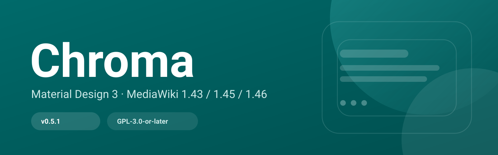
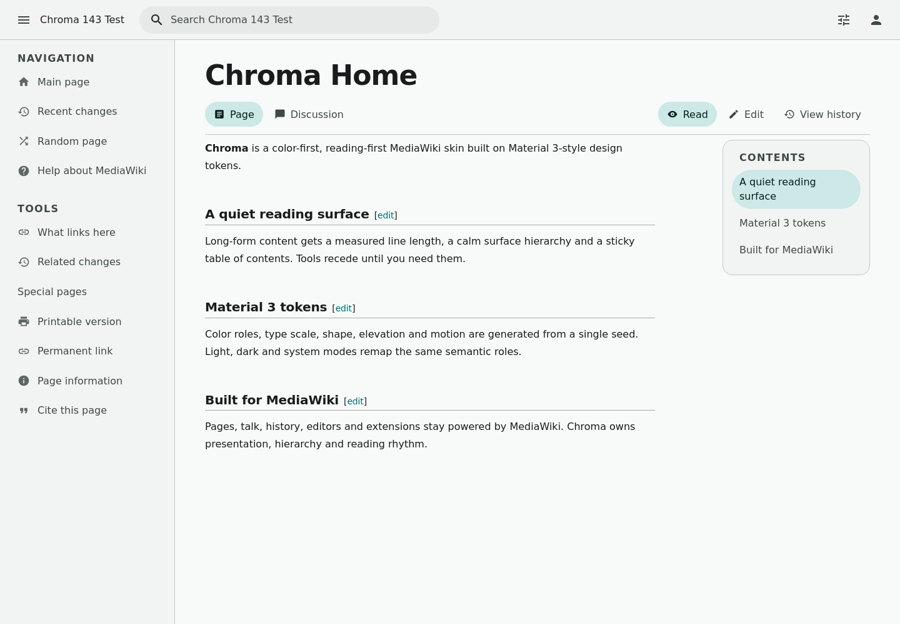
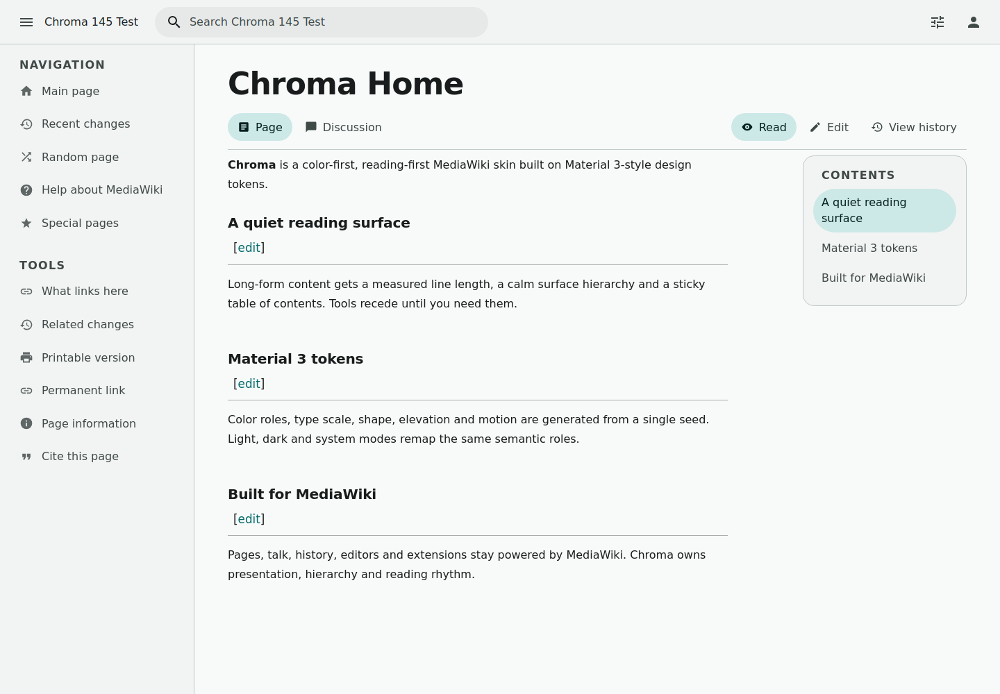
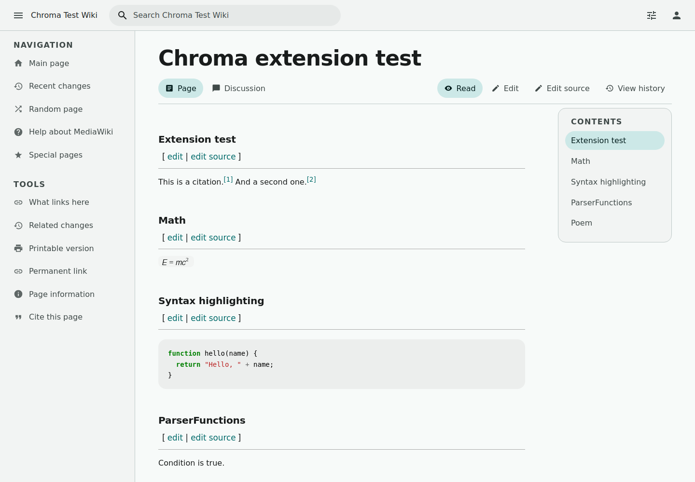
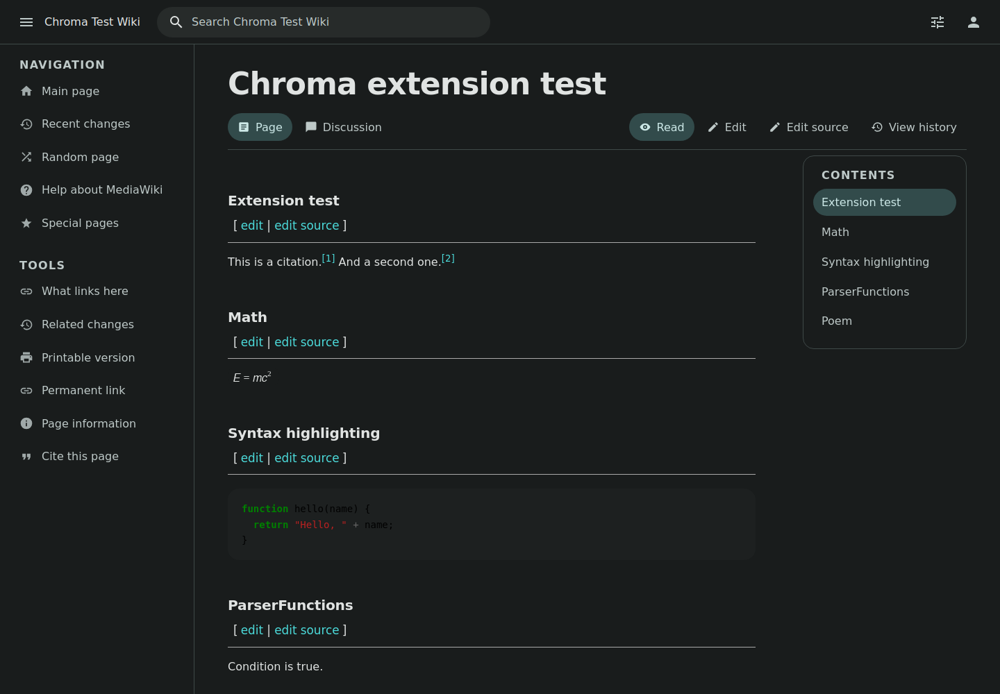
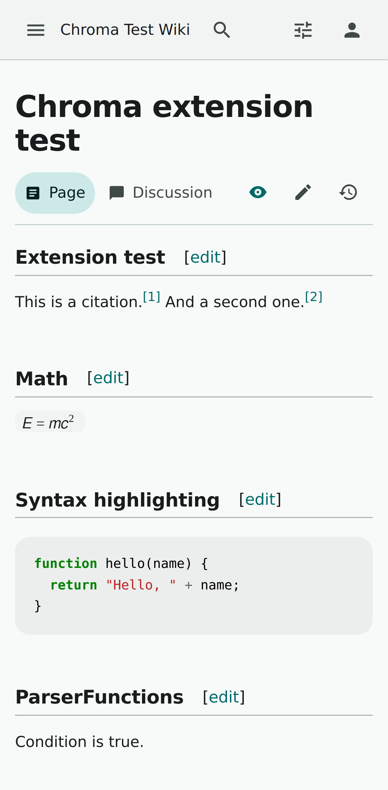
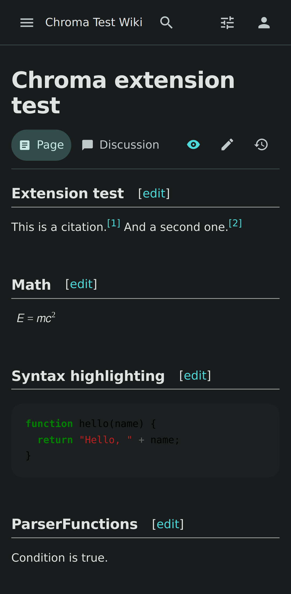
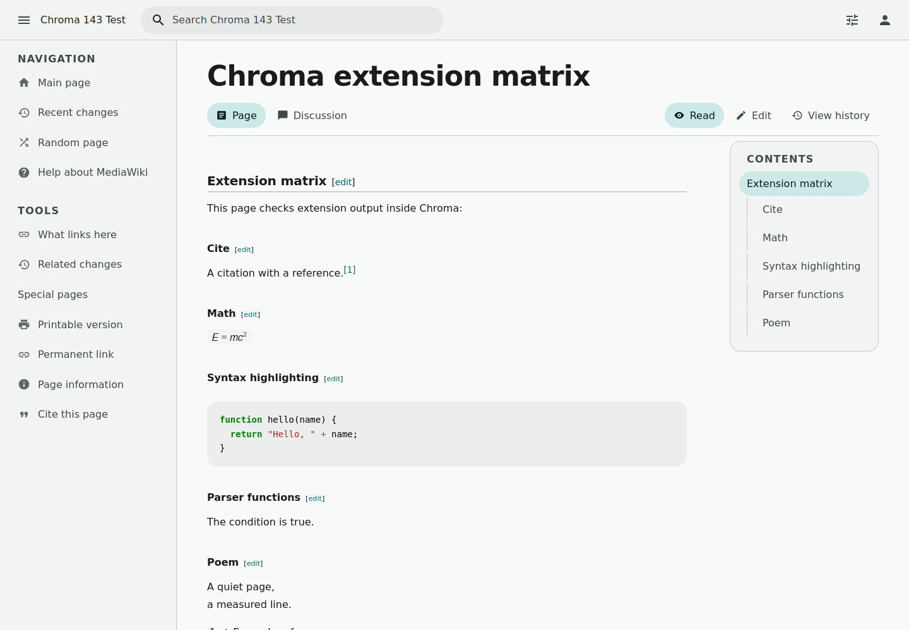
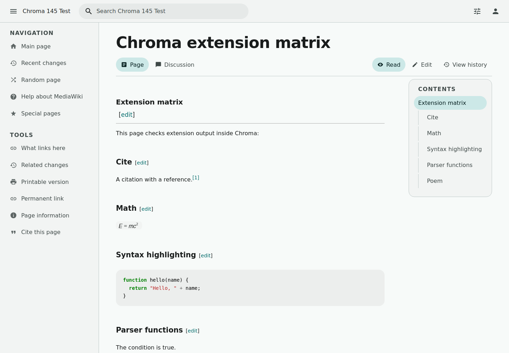

<p align="right"><a href="README.md">简体中文</a> · <strong>English</strong></p>


# Chroma

Color for MediaWiki.

[](https://github.com/chroma-mediawiki/mediawiki-skins-Chroma/actions/workflows/ci.yml)
[](LICENSE)
[](https://chroma-mediawiki.github.io/en/guide/compatibility)
[](https://qm.qq.com/q/zSaZRWS4eY)
[](https://b23.tv/QiGlLcm)

> Docs & website: https://chroma-mediawiki.github.io/en/
>
> Status: v0.5.2. Real MediaWiki 1.43 / 1.45 / 1.46 installs, a 30-extension Tier 1 matrix, and a MobileFrontend takeover. CI green.



## Screenshots

All screenshots come from a real MediaWiki + SQLite install with Chroma enabled.

### MediaWiki 1.43.0 / 1.45.0

| MediaWiki 1.43 LTS | MediaWiki 1.45 |
|---|---|
|  |  |

### MediaWiki 1.46.0 with Cite, Math, SyntaxHighlight, InputBox and more

| Light | Dark |
|---|---|
|  |  |

### Mobile (MediaWiki 1.46.0 + MobileFrontend takeover)

| Light | Dark |
|---|---|
|  |  |

Extension matrix (1.43 / 1.45, Cite, Math, SyntaxHighlight, InputBox, Poem and more):

| MediaWiki 1.43 | MediaWiki 1.45 |
|---|---|
|  |  |

> Mobile UAs use Chroma directly (MobileFrontend takeover); MinervaNeue is no longer required.

## Features

- **MD3 token system:** color roles, type scale, shape, elevation, motion and state layers. Not a complete MD3 component library.
- **M3 Expressive subset:** larger shapes/radii, spring motion, top-app-bar menus and selected Expressive patterns.
- **Dynamic color:** seed `#006A6A` by default with teal / blue / green / violet presets; users can choose color and scheme in Preferences.
- **Two layouts:** app (top bar + drawer) and reading layout (closer to Vector 2022), switchable at any time.
- **Reading mode:** hides the drawer and page actions, constrains and centers long-form content.
- **Search suggestions:** core `mediawiki.searchSuggest`, styled as MD3 surfaces.
- **Special pages:** login (Codex), history, diffs and Preferences share Material surfaces.
- **No external requests:** fonts, icons and scripts ship with the skin; no CDN.
- **Accessibility:** keyboard support and `prefers-reduced-motion`; there is no automated axe suite yet, and a full manual audit remains open.
- **Page structure:** title, page tabs and actions; grouped sidebar with icons; nested TOC + scroll-spy; citations as editorial pull quotes.

## Versions & downloads

| MediaWiki | Branch | Release |
|---|---|---|
| 1.43 LTS | `REL1_43` | [v0.5.2-REL1_43](https://github.com/chroma-mediawiki/mediawiki-skins-Chroma/releases/tag/v0.5.2-REL1_43) |
| 1.45 | `REL1_45` | [v0.5.2-REL1_45](https://github.com/chroma-mediawiki/mediawiki-skins-Chroma/releases/tag/v0.5.2-REL1_45) |
| 1.46 | `REL1_46` | [v0.5.2-REL1_46](https://github.com/chroma-mediawiki/mediawiki-skins-Chroma/releases/tag/v0.5.2-REL1_46) |

Each release ships a ZIP that can be extracted directly into `skins/Chroma`. `main` is development and is not guaranteed to match a release.

## Install

1. Download the release ZIP matching your MediaWiki version and extract it into `skins/Chroma`.
2. Add this to the end of `LocalSettings.php`:

```php
wfLoadSkin( 'Chroma' );
$wgDefaultSkin = 'chroma';

// Optional: MobileFrontend takeover
// $wgDefaultMobileSkin = 'chroma';
```

See [Installation](https://chroma-mediawiki.github.io/en/guide/installation) for full steps and troubleshooting.

## Configuration

```php
$wgChromaDefaultSeed = '#006A6A';   // theme seed
$wgChromaDefaultScheme = 'system';  // system | light | dark
$wgChromaDefaultLayout = 'app';     // app | reading
$wgChromaDefaultReadingMode = false;
$wgChromaAllowUserColor = true;
$wgChromaAllowUserLayout = true;
$wgChromaAllowUserReadingMode = true;
```

See the [configuration docs](https://chroma-mediawiki.github.io/en/guide/configuration) for every option and default. To change the theme color, dark mode or custom colors, see [Themes & color](https://chroma-mediawiki.github.io/en/guide/theming).

## Compatibility

- MediaWiki 1.43 LTS / 1.45 / 1.46, maintained on `REL1_43`, `REL1_45`, `REL1_46`.
- Tier 1 extensions: 31 configured on the 1.46 harness (AbuseFilter disabled for an environment dependency); 30-extension matrices on 1.43.0 / 1.45.0. See [compatibility](https://chroma-mediawiki.github.io/en/guide/compatibility); not every community extension is verified.
- MobileFrontend: **full takeover**. Install MobileFrontend and set `$wgDefaultMobileSkin = 'chroma';`; mobile UAs use Chroma's responsive layout directly.

## Development

```bash
npm install
npm run tokens   # regenerate resources/styles/tokens.css from the seed
```

- Local MediaWiki test environment: [testing and compatibility](https://chroma-mediawiki.github.io/en/dev/testing).
- [Development overview](https://chroma-mediawiki.github.io/en/dev/) and [compatibility](https://chroma-mediawiki.github.io/en/guide/compatibility).

## License

GPL-3.0-or-later. Third-party licenses are in [NOTICE](NOTICE).

Chroma is an independent community project, not affiliated with or endorsed by Google. Material Design and Material 3 are trademarks of Google LLC.
