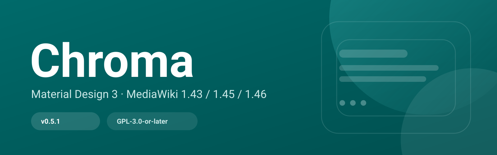
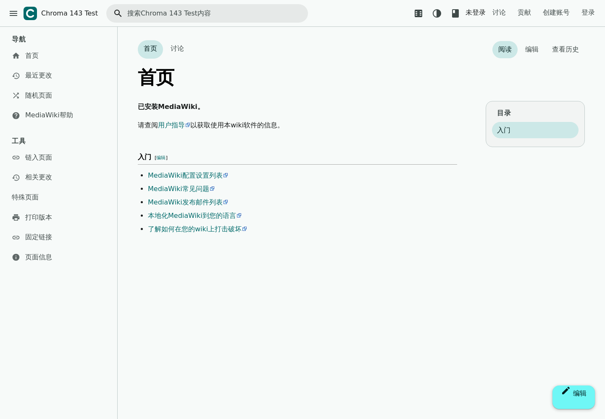
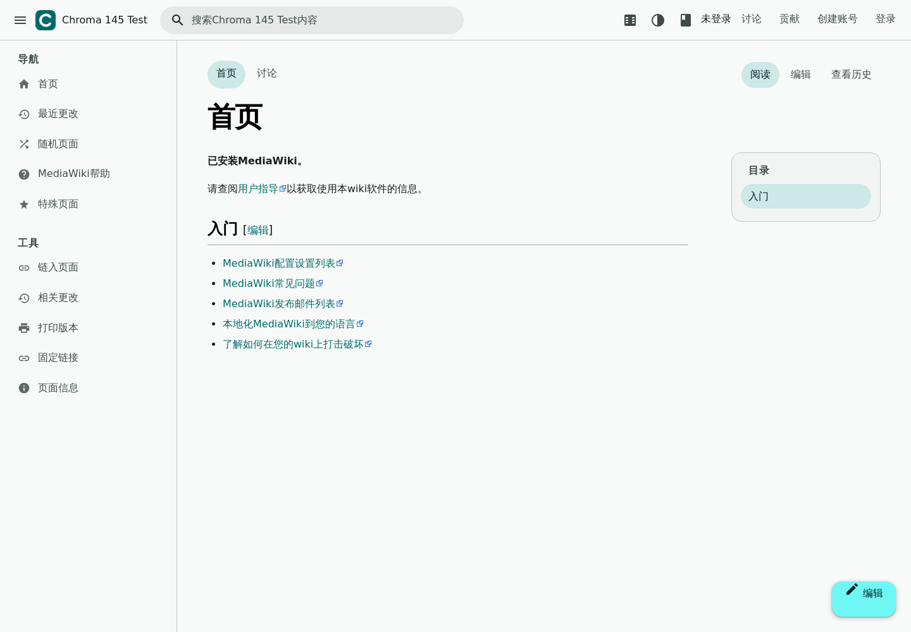
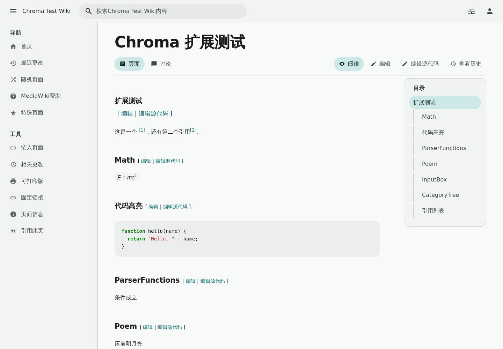
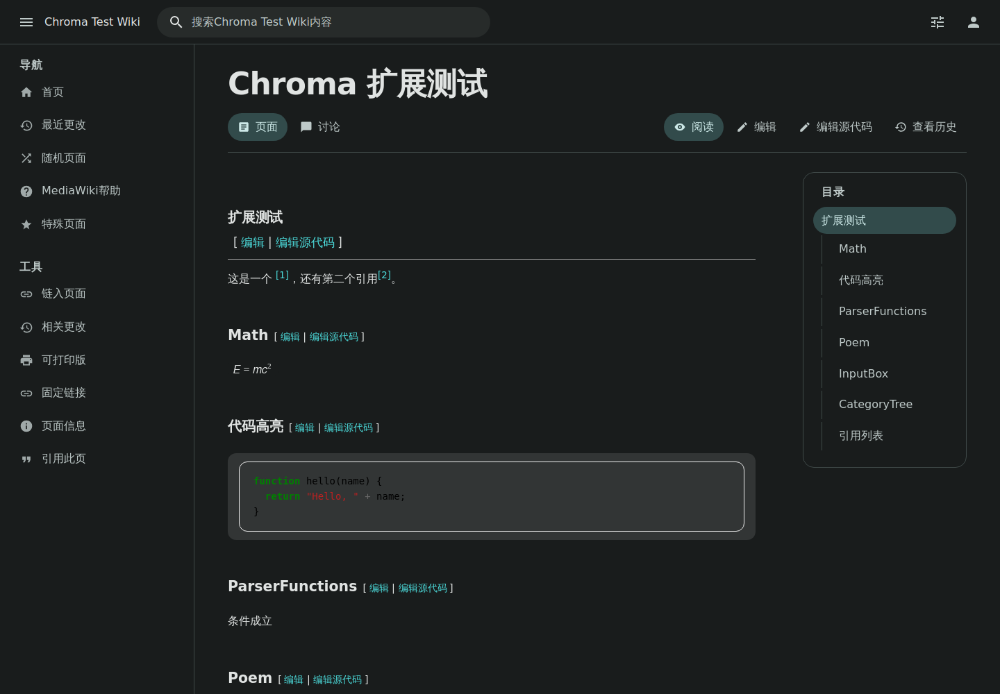
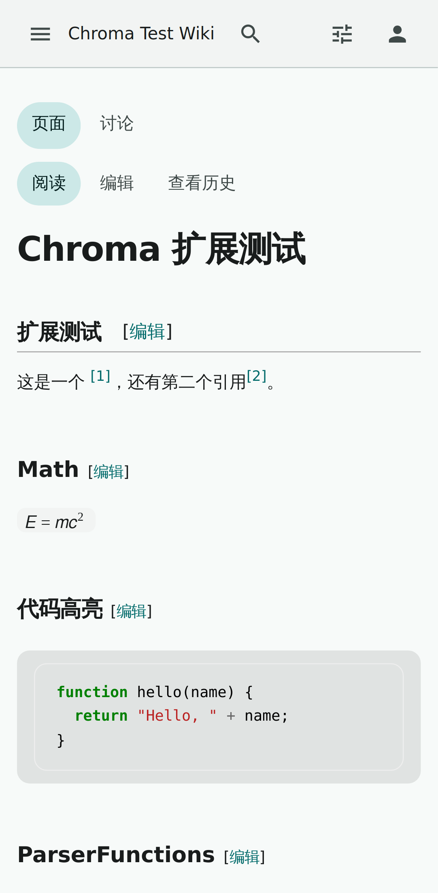
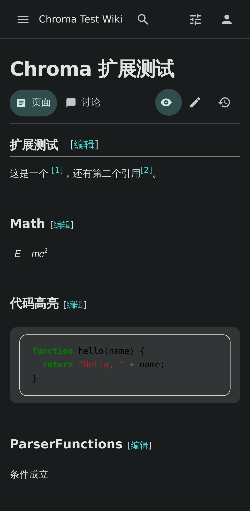
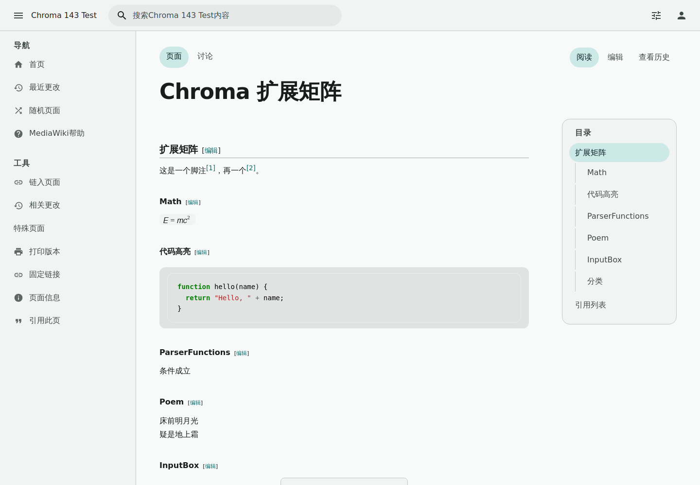
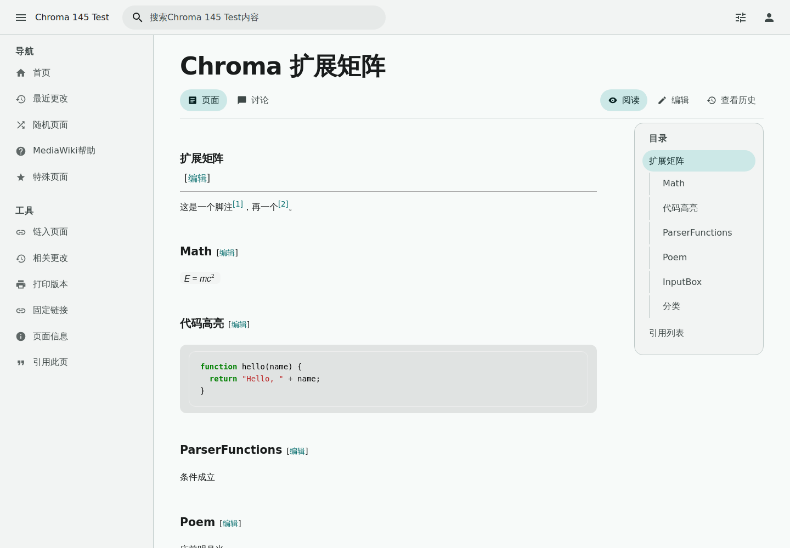

# Chroma

受 Material Design 3 与 M3 Expressive 启发的 MediaWiki 皮肤。

[](https://github.com/chroma-mediawiki/mediawiki-skins-Chroma/actions/workflows/ci.yml)
[](LICENSE)
[](docs/COMPAT-MATRIX.md)
[](https://chroma-mediawiki.github.io/mediawiki-skins-Chroma/demo/)

> 状态：v0.5.2。1.43 / 1.45 / 1.46 真机 + 30 个 Tier 1 扩展矩阵通过；MobileFrontend 手机端全接管；CI 与 Pages 通过。



## 真机截图

以下全部来自本地安装的 MediaWiki + SQLite，启用 Chroma 后的实际渲染，不是静态原型。

### MediaWiki 1.43.0 / 1.45.0

| MediaWiki 1.43 LTS | MediaWiki 1.45 |
|---|---|
|  |  |

### MediaWiki 1.46.0（含 Cite、Math、SyntaxHighlight、InputBox 等扩展）

| 浅色 | 深色 |
|---|---|
|  |  |

### 手机端（MediaWiki 1.46.0 + MobileFrontend 全接管）

| 浅色 | 深色 |
|---|---|
|  |  |

扩展矩阵（1.43 / 1.45，Cite、Math、SyntaxHighlight、InputBox、Poem 等）：

| MediaWiki 1.43 | MediaWiki 1.45 |
|---|---|
|  |  |

> 手机 UA 默认直接使用 Chroma（MobileFrontend 全接管），不再依赖 MinervaNeue。

## 特性

- MD3 token 系统：色彩角色、字阶、形状、海拔、动效与状态层；不是完整 MD3 组件库。
- M3 Expressive 视觉子集：更大圆角/形状、弹簧动效、顶部应用栏菜单与部分 Expressive 模式。
- 动态色彩：默认 seed `#006A6A`，提供 teal / blue / green / violet 四套预设；用户可在偏好设置选择主题色与明暗模式。
- 两种布局：应用式（顶栏 + 导航抽屉）与阅读式（接近 Vector 2022），可随时切换。
- 阅读模式：隐藏侧栏与操作栏，正文限宽居中，专注长文阅读。
- 搜索联想：接入核心 `mediawiki.searchSuggest`，搜索结果使用 MD3 面板样式。
- 特殊页：登录（Codex）、历史、版本差异、偏好设置统一 Material 样式。
- 无外部请求：字体、图标与脚本全部随皮肤分发，不依赖 CDN。
- 可访问性：自动化 axe-core 检查（WCAG 2.2 AA 规则）为 0 violations；完整人工审计仍待补。支持键盘操作与 `prefers-reduced-motion`。
- 页面结构：标题、页面标签与操作同排；侧栏分组 + 图标；目录支持嵌套与 scroll-spy；引用改为编辑式 pull quote。


## 版本与下载

| MediaWiki | 分支 | 发布 |
|---|---|---|
| 1.43 LTS | `REL1_43` | [v0.5.2-REL1_43](https://github.com/chroma-mediawiki/mediawiki-skins-Chroma/releases/tag/v0.5.2-REL1_43) |
| 1.45 | `REL1_45` | [v0.5.2-REL1_45](https://github.com/chroma-mediawiki/mediawiki-skins-Chroma/releases/tag/v0.5.2-REL1_45) |
| 1.46 | `REL1_46` | [v0.5.2-REL1_46](https://github.com/chroma-mediawiki/mediawiki-skins-Chroma/releases/tag/v0.5.2-REL1_46) |

每个 Release 提供可直接解压到 `skins/Chroma` 的 ZIP。`main` 分支用于开发，不保证与 Release 同步。

## 安装

1. 下载与你 MediaWiki 版本对应的 Release ZIP，解压到 `skins/Chroma`。
2. 在 `LocalSettings.php` 末尾加入：

```php
wfLoadSkin( 'Chroma' );
$wgDefaultSkin = 'chroma';

// 可选：MobileFrontend 全接管手机端
// $wgDefaultMobileSkin = 'chroma';
```

## 配置

```php
$wgChromaDefaultSeed = '#006A6A';   // 主题色种子
$wgChromaDefaultScheme = 'system';  // system | light | dark
$wgChromaDefaultLayout = 'app';     // app | reading
$wgChromaDefaultReadingMode = false;
$wgChromaAllowUserColor = true;
$wgChromaAllowUserLayout = true;
$wgChromaAllowUserReadingMode = true;
```

完整配置与用户偏好说明见 [docs/THEMING.md](docs/THEMING.md)。

## 兼容性

- MediaWiki 1.43 LTS / 1.45 / 1.46，分别维护于 `REL1_43`、`REL1_45`、`REL1_46` 分支。
- Tier 1 扩展：1.46 harness 配置 31 个（AbuseFilter 因环境依赖未启用）；1.43.0 / 1.45.0 各安装 30 个扩展的矩阵。社区扩展清单见 [docs/COMPATIBILITY.md](docs/COMPATIBILITY.md)，尚未全部逐项验证。
- MobileFrontend：**全接管**。安装 MobileFrontend 并设置 `$wgDefaultMobileSkin = 'chroma';` 后，手机 UA 直接使用 Chroma 响应式布局，不再依赖 MinervaNeue。

## 开发

```bash
npm install
npm run tokens   # 根据 seed 色重新生成 resources/styles/tokens.css
npm run serve    # 在 http://localhost:8080/demo/ 预览静态原型
```

- 静态原型：`demo/`（GitHub Pages 部署）。
- 本地 MediaWiki 测试环境说明：见 [docs/COMPAT-MATRIX.md](docs/COMPAT-MATRIX.md)。
- 设计规范：[docs/SPEC.md](docs/SPEC.md)；版本差异：[docs/COMPAT-MATRIX.md](docs/COMPAT-MATRIX.md)。

## 许可

GPL-3.0-or-later。第三方组件许可见 [NOTICE](NOTICE)。

Chroma 是独立的社区项目，与 Google 无关联，也未获其背书。Material Design 与 Material 3 是 Google LLC 的商标。
